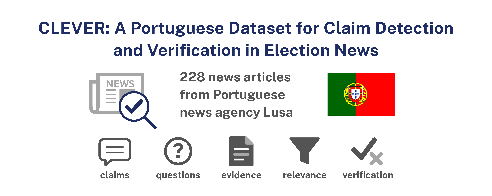

## Overview
**CLEVER** is a dataset of European Portuguese news articles annotated for **factual claims** and for their **verification with external evidence**, comprising **228 articles** and **1,187 claim and non-claim annotations**. The articles were provided by **LUSA, the Portuguese News Agency**, and are related to the Portuguese legislative election held on 18 May 2025. Claims were annotated independently by two annotators with expertise in journalism, and each article was reviewed by a linguistics specialist, following an annotation scheme grounded on [ClaimPT](https://github.com/LIAAD/ClaimPT). Each of the **140 claim spans** is further associated with manually formulated **verification questions**, the **news documents** these questions retrieve from the LUSA News Corpus, the **relevance** of each document, the **relation** of each relevant document to the claim span (*Supported*, *Refuted* or *Not Enough Information*, NEI), the **evidence excerpts** that sustain this relation, and a **verification** label for the claim span. CLEVER is released to support research on claim detection and question-driven fact-checking in European Portuguese, from the identification of claims in news articles, the generation of verification questions and the retrieval of evidence to the classification of its relation to the claim. Baselines are provided for **verification question generation**.


## Repository Structure
```
├── dataset_sample/
│   ├── annotations.jsonl
│   ├── annotations.pretty.json
│   └── news_articles/
│       └── *.txt
│
├── synthetic_questions_sample/
│   ├── annotations.jsonl
│   └── annotations.pretty.json
│
├── generative_baselines/
│   ├── configs/
│   ├── split/
│   ├── src/
│   └── requirements.txt
│
├── CLEVER Annotation Manual.pdf
│
├── clever.png
├── Licence
└── README.md
```
---


## Corpus Statistics

### Articles and Claims

| **Property**                                                  | **Description**                    |
| ------------------------------------------------------------- | ---------------------------------- |
| **Total Articles**                                            | 228                                |
| **Average Article Length**                                    | 475.5 words                        |
| **Annotated Articles (with at least one Claim or Non-Claim)** | 218                                |
| **Claim Annotations**                                         | 115                                |
| **Non-Claim Annotations**                                     | 1,072                              |
| **Claim Spans**                                               | 140                                |
| **Claim Objects**                                             | 143                                |
| **Claimers**                                                  | 198                                |
| **Time Expressions**                                          | 72                                 |
| **Claim Topics**                                              | 115 (1 per claim)                  |
| – Politics                                                    | 93                                 |
| – Economy                                                     | 12                                 |
| – Health                                                      | 4                                  |
| – Society                                                     | 4                                  |
| – International                                               | 1                                  |
| – Science and Environment                                     | 1                                  |
| **News Article Topics**                                       | 228 (1 per article, all politics)  |
| **Publication Times**                                         | 228 (1 per article)                |

### Verification Annotations

| **Property**                                          | **Description**                     |
| ----------------------------------------------------- | ----------------------------------- |
| **Verification Questions**                            | 307 (2.19 per claim span)           |
| – Claim spans with 1 question                         | 16                                  |
| – Claim spans with 2 questions                        | 88                                  |
| – Claim spans with 3 questions                        | 29                                  |
| – Claim spans with 4 questions                        | 7                                   |
| **Question-Document Retrievals (top 5 per question)** | 1,535                               |
| **Claim Span-Document Pairs**                         | 1,269                               |
| – Relevant                                            | 312 (24.6%)                         |
| – Irrelevant                                          | 957 (75.4%)                         |
| **Relations of the Relevant Pairs**                   | 312                                 |
| – Supported                                           | 128 (41.0%)                         |
| – Refuted                                             | 34 (10.9%)                          |
| – NEI                                                 | 150 (48.1%)                         |
| **Distinct LUSA Documents**                           | 1,162                               |
| **Evidence Excerpts**                                 | 527                                 |
| – In Supported pairs                                  | 187                                 |
| – In Refuted pairs                                    | 54                                  |
| – In NEI pairs                                        | 286                                 |
| **Claim Span Verification**                           | 140                                 |
| – Supported                                           | 60                                  |
| – Refuted                                             | 17                                  |
| – NEI                                                 | 63                                  |

---


## Data Format

The **CLEVER** dataset is provided in **JSONL** format, where each line corresponds to a news article with its annotations (`annotations.pretty.json` has the same articles, indented).

| Field | Description |
|--------|-------------|
| `document` | News article filename (the text is in `news_articles/`) |
| `news_article_topic` | Topic of the news article |
| `publication_time` | Date of the news publication, in ISO 8601 (e.g., `2025-05-07`) |
| `items` | Annotated claims and non-claims of the article |
| `identity_links` | Identity links between mentions of the same referent |
| `id` | Unique identifier for each claim or non-claim |
| `claim` | Boolean indicating whether the annotation is a claim (`true`) or non-claim (`false`) |
| `begin_character` | Begin character offset of the annotated text span |
| `end_character` | End character offset of the annotated text span |
| `text_segment` | Text segment corresponding to the annotated span |
| `claim_topic` | Topic of the claim (e.g., politics, economy, health) |
| `stance` | Position of the claimer towards the claim: `Affirm` or `Refute` |
| `claim_object` | Claim objects of the claim, each with its text and character offsets |
| `claimer` | Mentions of the entity making the claim, each with its text, offsets and `type` (`person` or `institution`) |
| `time` | Temporal expressions associated with the claim, each with its text and offsets |
| `claim_span` | Claim spans of the claim, each with its `text`, `begin` and `end` positions and its verification annotations |

Non-claims have only the fields from `id` to `text_segment`. `claim_object`, `claimer`, `time` and `claim_span` are always lists; `time` is empty in 14 claims and `claimer` in one. Each identity link goes `from` one mention `to` another, each with its `label` (`claimer`, `claim_object`, `time` or `publication_time`), `text`, `begin` and `end`; the `text` is as written in the article (e.g., `07 mai 2025` for the publication time). `stance` and the claimer `type` are `null` in one claim, and `identity_links` in two articles.

Besides `text`, `begin` and `end`, each claim span contains:

| Field | Description |
|--------|-------------|
| `verification` | Verification label of the claim span: `Supported`, `Refuted` or `NEI` (see [Annotation Guidelines](#annotation-guidelines)) |
| `questions` | Verification questions, each with a `question_id` and its `text` |
| `retrieved_documents` | LUSA news documents retrieved by the questions |

Each retrieved document contains:

| Field | Description |
|--------|-------------|
| `doc_id` | Identifier of the document in CLEVER |
| `lusa_doc_id` | Identifier of the document in LUSA |
| `headline` | Headline of the news document |
| `published_at` | Publication date and time of the news document |
| `author` | Author of the news document |
| `genre` | Journalistic genre (e.g., `Notícia`) |
| `word_count` | Number of words of the news document |
| `retrieved_by` | Questions that retrieved the document (`question_id`), with the document's `rank` for each (1 to 5) |
| `relevant` | Boolean indicating whether the document is relevant to the claim span |
| `relation` | Relation of the document to the claim span: `Supported`, `Refuted` or `NEI` (`null` for irrelevant documents) |
| `evidence_excerpts` | Passages of the document that sustain the relation, each with an `evidence_id`, `text`, `begin` and `end` |
| `content` | Full text of the news document |

All offsets are character positions in the article text in `news_articles/` (starting at 0, end excluded), except those of evidence excerpts, which refer to the document `content`. `question_id`, `doc_id` and `evidence_id` are unique across the dataset. A document retrieved for several claim spans keeps its `doc_id`, but its `relevant`, `relation` and `evidence_excerpts` refer to each claim span.

---

### Example (JSON excerpt)

The claim `clever_016_c7` with two of the eleven documents retrieved for its claim span (a *Supported* document with two evidence excerpts and an irrelevant one) and the three identity links of the article. Long texts are shortened with `[...]`.

```json
[
  {
    "document": "clever_016.txt",
    "news_article_topic": "politics",
    "publication_time": "2025-05-07",
    "items": [
      {
        "id": "clever_016_c7",
        "claim": true,
        "begin_character": 3686,
        "end_character": 3830,
        "text_segment": "Vi a AD, em determinados momentos, com muitas dúvidas sobre a questão da direção executiva e falou-se até de retirar poderes à direção executiva",
        "claim_topic": "politics",
        "stance": "Affirm",
        "claim_object": [{"text": "retirar poderes", "begin": 3795, "end": 3810}],
        "claimer": [
          {"text": "O líder da IL", "begin": 787, "end": 800, "type": "person"},
          {"text": "Rui Rocha", "begin": 942, "end": 951, "type": "person"},
          {"text": "Rui Rocha", "begin": 3625, "end": 3634, "type": "person"}
        ],
        "time": [{"text": "hoje", "begin": 179, "end": 183}],
        "claim_span": [
          {
            "text": "falou-se até de retirar poderes à direção executiva",
            "begin": 3779,
            "end": 3830,
            "verification": "Supported",
            "questions": [
              {
                "question_id": 41,
                "text": "A AD falou em retirar poderes à direção executiva do SNS, durante o primeiro mandato de Luís Montenegro?"
              },
              {
                "question_id": 42,
                "text": "Quando é que a AD, durante o primeiro mandato de Luís Montenegro, falou em retirar poderes à direção executiva do SNS?"
              },
              {
                "question_id": 43,
                "text": "A AD chegou a ter muitas dúvidas sobre a direção executiva do SNS, durante o primeiro mandato de Luís Montenegro?"
              }
            ],
            "retrieved_documents": [
              {
                "doc_id": 164,
                "lusa_doc_id": "44493035",
                "headline": "ENTREVISTA: Marta Temido lamenta \"oportunidade perdida\" com retirada de poderes à Direção Executiva do SNS (C/ÁUDIO E VÍDEO)",
                "published_at": "2025-03-01T09:00:03",
                "author": "João Roque",
                "genre": "Notícia",
                "word_count": 781,
                "retrieved_by": [{"question_id": 41, "rank": 1}],
                "relevant": true,
                "relation": "Supported",
                "evidence_excerpts": [
                  {
                    "evidence_id": 75,
                    "text": "A antiga ministra da Saúde Marta Temido lamenta a retirada de poderes à Direção Executiva do SNS por ser uma \"oportunidade perdida\" de melhorar a máquina dos cuidados de saúde, realçando que todos os grupos privados têm uma coordenação.",
                    "begin": 171,
                    "end": 407
                  },
                  {
                    "evidence_id": 76,
                    "text": "Marta Temido disse assistir à retirada de poderes à Direção Executiva com \"a compreensão de que a realidade é evolutiva\".",
                    "begin": 2179,
                    "end": 2300
                  }
                ],
                "content": "*** Serviços áudio e vídeo disponíveis em www.lusa.pt *** *** Helena Neves (texto), Hugo Fragata (vídeo) e André Kosters (fotos) (REPETIÇÃO) Lisboa, 01 mar 2025 (Lusa) [...]"
              },
              {
                "doc_id": 174,
                "lusa_doc_id": "38926220",
                "headline": "Administradores Hospitalares manifestam dúvidas sobre nova direção executiva do SNS (C/ÁUDIO)",
                "published_at": "2022-07-07T22:20:32",
                "author": "Helena Neves Marques",
                "genre": "Notícia",
                "word_count": 509,
                "retrieved_by": [{"question_id": 43, "rank": 4}],
                "relevant": false,
                "relation": null,
                "evidence_excerpts": [],
                "content": "*** Serviço áudio disponível em www.lusa.pt *** Lisboa, 07 jul 2022 (Lusa) [...]"
              }
            ]
          }
        ]
      }
    ],
    "identity_links": [
      {
        "from": {"label": "time", "text": "hoje", "begin": 179, "end": 183},
        "to": {"label": "publication_time", "text": "07 mai 2025", "begin": 133, "end": 144}
      },
      {
        "from": {"label": "claimer", "text": "O líder da IL", "begin": 787, "end": 800},
        "to": {"label": "claimer", "text": "Rui Rocha", "begin": 942, "end": 951}
      },
      {
        "from": {"label": "claimer", "text": "Rui Rocha", "begin": 3625, "end": 3634},
        "to": {"label": "claimer", "text": "Rui Rocha", "begin": 942, "end": 951}
      }
    ]
  }
]
```

---

## Annotation Guidelines

Detailed annotation instructions, including procedures, quality-control measures, and schema definitions, are available in the document:

📄 [CLEVER Annotation Manual (PDF)](CLEVER%20Annotation%20Manual.pdf)

The annotation of CLEVER is summarized below: the claims and their attributes, the verification questions, the evidence retrieved with them and the verification of each claim span.

### Claims

The articles were provided by LUSA under a collaboration protocol: articles containing the keywords *Portuguese legislative elections*, filtered by comparing the first 300 characters of their body text against the query, with duplicates removed. Each article was annotated independently by two annotators with expertise in journalism and then reviewed by a linguistics specialist experienced in corpus curation, in the INCEpTION platform. The annotation scheme is grounded on the scheme of [ClaimPT](https://github.com/LIAAD/ClaimPT), with the following elements:

* **Metadata:** the *News Article Topic* and the *Publication Time* of each article;
* **Claim:** a factual assertion about the real world that can be verified and is of public relevance, typically a declarative sentence attributed to a source other than the journalist and marked by reporting verbs such as *state*, *assert* or *mention*;
* **Non-Claim:** an utterance expressing an opinion, a belief or a personal judgment; non-claims are annotated with their text segment only. Statements about hypothetical or future events are not annotated as claims;
* **Claim Span:** the exact text segment of an independently verifiable factual proposition of the claim; a claim can have several claim spans;
* **Claim Object:** the core element or issue to which the claim span refers;
* **Claimer:** the entity responsible for the claim, such as a person, an institution, a political party, an organization, a study, a report or an investigation;
* **Stance:** the position of the claimer towards the content of the claim, affirming or refuting it;
* **Time:** explicit, implicit or relative temporal expressions tied to the claim;
* **Topic:** the thematic domain of the claim;
* **Links:** attribute links connect each claim to its claim spans, claim objects, claimers and time expressions, and identity links connect mentions of the same referent, such as a pronoun and its antecedent or a temporal mention and the publication time.

In the released files, the attribute links are represented by nesting the claim spans, claim objects, claimers and time expressions in their claim, and the identity links are listed in `identity_links`. Each claim also nests the claimer and time mentions connected by identity links, directly or through other mentions, to the ones linked to it, and the claim objects connected in the same way whose text lies within the claim.

Agreement between the two annotators was measured with the F1 (Sørensen-Dice) and the Jaccard overlap of their annotations, with a tolerance of ±4 characters at the span boundaries. The claim attributes were compared only on the claims identified by both annotators.

| **Annotation** | **F1** | **Jaccard (%)** |
|------------|------|------|
| Claim | 0.4574 | 29.65 |
| Non-Claim | 0.5301 | 36.06 |
| Claim Span | 0.6711 | 50.50 |
| Claim Object | 0.2906 | 17.00 |
| Claimer | 0.4646 | 30.26 |
| Time | 0.8478 | 73.58 |

Micro-F1 is 0.5220 for Claim/Non-Claim and 0.5652 for the claim attributes (Macro-F1 0.4937 and 0.5685).

### Verification Questions

One or more verification questions were manually formulated for each claim span, to represent the factual information needed for its verification in a form suitable for evidence retrieval. The questions take into account the claim object of the claim span and any other annotated information needed to preserve its meaning:

* questions are centered on the claim span and focus on its claim object (the most specific term of the claim span), and a claim with several claim spans has independent questions for each of them;
* the aim is to formulate two questions: a **general** question on the broad theme of the claim object and a **specific** question on the factual elements that require validation, such as numbers, dates, measures or names of institutions; a single question is formulated when the claim span cannot be split, and more questions when it has further facts to verify;
* pronouns are replaced by the names of the entities they refer to;
* questions are neutral, focus on the alleged fact rather than on the opinion of the claimer, and do not depend on whether the claimer affirms or refutes it;
* questions include the temporal boundary of the claim and, for local claims, the region it refers to;
* the claimer is included when the validity of the fact depends on who states it, claims about studies or reports ask for the specific document, and comparisons are split to obtain the values of both terms.

### Evidence

Each question was submitted to a search API over the **LUSA News Corpus**, considering only documents published before the article containing the claim, and the first five distinct news items were kept for each question, counting re-issues of the same news item once (1,535 retrievals). Documents retrieved by several questions of the same claim span were consolidated, giving **1,269 claim span-document pairs**, each annotated manually by one annotator:

* **Relevance:** a document is *Relevant* when it contains information pertinent to the factual situation represented by the claim span, and *Irrelevant* otherwise. Sharing words with the claim span or with its questions is not enough: a document that concerns a different actor and factual episode is *Irrelevant*, even when it mentions the same entities;
* **Relation:** each relevant document is classified as *Supported* (its evidence supports what the claim span asserts about the claim object), *Refuted* (its evidence contradicts it) or *NEI* (it does not contain sufficient information to establish either);
* **Evidence excerpts:** for each relevant document, one or more passages that sustain its relation (for an *NEI* document, the passages that make it relevant).

The verification questions determine which documents are retrieved, but do not take part in the relevance or relation decisions. They are kept as retrieval provenance in `retrieved_by`.

### Verification

The relations of the relevant documents of each claim span are aggregated into its `verification` label:

| Relations of the relevant documents | Claim span verification |
|---|---|
| At least one *Supported* and no *Refuted* | `Supported` |
| At least one *Refuted* and no *Supported* | `Refuted` |
| Only *NEI* | `NEI` |
| No relevant document | `NEI` |
| Both *Supported* and *Refuted* | `NEI` |

Researchers interested in replicating the annotation or training models should refer to the annotation manual.

---

## Dataset Access

### Sample Dataset

A sample subset (20 annotated articles) is included in the repository under the `dataset_sample/` directory: 8 articles with claims (11 claims, 12 claim spans, 27 verification questions and 110 claim span-document pairs, with 62 evidence excerpts) and 12 articles with only non-claims.

### Full Dataset

The complete dataset (228 articles) is protected by a **Data Use Agreement** and will be made available once the research paper is published.

---

## Dataset Split

The dataset is divided into **train** and **test** subsets at the article level: each article is assigned entirely to one subset by a uniform draw over the 228 articles, so that the articles with claims give exactly 40 training and 100 test claim spans (29 and 48 articles), and the articles without claims are divided in the same proportion. Of the 1,162 distinct LUSA documents, 15 are retrieved for claim spans of both subsets.

| Split     | # News Articles | Claims | Claim Spans | Questions | Claim Span-Document Pairs | Relevant (Supported / Refuted / NEI) | Evidence Excerpts | Verification (Supported / Refuted / NEI) |
| --------- | --------------- | ------ | ----------- | --------- | ------------------------- | ------------------------------------ | ----------------- | ---------------------------------------- |
| **Train** | 72              | 36     | 40          | 91        | 379                       | 95 (41 / 9 / 45)                     | 164               | 17 / 6 / 17                              |
| **Test**  | 156             | 79     | 100         | 216       | 890                       | 217 (87 / 25 / 105)                  | 363               | 43 / 11 / 46                             |
| **Total** | 228             | 115    | 140         | 307       | 1,269                     | 312 (128 / 34 / 150)                 | 527               | 60 / 17 / 63                             |

---

## Synthetic Questions

[ClaimPT](https://github.com/LIAAD/ClaimPT) is a dataset of European Portuguese news articles from LUSA annotated with the claim scheme on which CLEVER is grounded, without verification questions. To provide additional training data for verification question generation (**Silver1073** in [Baselines](#baselines)), questions were generated automatically for the 522 claim spans in its data files. They are silver-standard data: only a sample was checked manually.

### Generation

Each claim span was sent in a separate request to `gemini-3.5-flash`, with temperature 0.0 and the output constrained to JSON (`{"questions": [...]}`). The prompt, in European Portuguese, contained the task instruction, question-formulation criteria based on those of CLEVER (see [Verification Questions](#verification-questions)) and six demonstrations built from CLEVER claim spans, each with example questions, followed by the claim span to process, its claim objects and claimers, the publication date and the article as context.

| **Property** | **Value** |
|---|---|
| **Claim Spans** | 522 |
| **Synthetic Questions** | 1,073 |
| **Questions per Claim Span** | 2.06 |
| **Claim Spans with 2 Questions** | 493 |
| **Claim Spans with 3 Questions** | 29 |

The prompt has a system instruction, with the criteria and the six demonstrations, and a message for each claim span, in which `{claim_span}`, `{context}` (the article), `{publication_time}`, `{claimers}` and `{claim_objects}` are filled in, the last two as bulleted lists:

<details>
<summary>Prompt (European Portuguese)</summary>

System instruction:

```text
És um anotador especializado em produzir perguntas para verificação de claims (fact-checking).
Recebes UM claim span de cada vez e devolves as perguntas que servem para verificar a veracidade desse span.

Elementos disponíveis:
- Claim span: segmento textual exato cuja veracidade tem de ser validada.
- Claim object(s): elemento, entidade ou número focal da alegação dentro do span.
- Claimer(s): quem profere a alegação.
- Time / Publication time: para anchoring temporal.
- Contexto: artigo completo, apenas para desambiguar pronomes/entidades e situar a alegação.

Princípio central:
- O objetivo é verificar a veracidade do CLAIM SPAN.
- Todas as perguntas devem incidir diretamente sobre o claim span e o seu conteúdo factual.
- Contexto, data, claimer e claim object são apenas auxiliares para interpretar, desambiguar e situar temporalmente. NÃO devem originar perguntas sobre informação periférica do artigo.

- Não gerar perguntas apenas sobre contexto, data, claimer ou claim object — exceto quando esses elementos forem indispensáveis para desambiguar ou restringir temporalmente a verificação.
- Antes de produzir a resposta, identificar mentalmente os subfactos mínimos necessários e gerar apenas uma pergunta por cada subfacto indispensável.
- Se a resposta a uma pergunta não alterar a decisão sobre a veracidade do span, essa pergunta não deve ser incluída.

Critérios para formulação de perguntas para verificação de claims:

1. Formulação das questões por segmento da claim
- As perguntas devem estar centradas obrigatoriamente no elemento claim span.
- Sempre que uma única alegação (claim) contiver múltiplos claim spans, devem ser elaboradas perguntas independentes para cada um deles (no nosso pipeline, cada chamada já corresponde a UM span).
- Cada pergunta deve estar estritamente vinculada ao claim object correspondente ao seu span.

2. Hierarquia e tipologia das questões
Para cada claim span, formular preferencialmente duas perguntas com níveis de especificidade distintos:
- Pergunta de nível geral: foca a temática ampla do claim object. Caso o objeto, isoladamente, não forneça contexto suficiente, integrar outros atributos da alegação — claimer, time e/ou os links de attribute e identity.
- Pergunta de nível específico: altamente direcionada ao foco central do claim object, detalhando os elementos factuais que necessitam de validação (números, datas, nomes, valores, instituições).
- Utilizar os links de Identity para substituir pronomes ("este sistema", "isso", "elas", "lá") pelos nomes próprios das entidades nas perguntas, garantindo clareza para a busca.

3. Adaptação em casos de escassez de contexto
- Quando a natureza do claim span não permita o desdobramento em duas perguntas distintas, formular apenas UMA.
- Nesses casos, a pergunta deve fundamentar-se no tema central do claim object, podendo recorrer aos restantes elementos da claim relevantes para localizar a evidência.

Critérios adicionais:
- Neutralidade: evitar termos subjetivos ou que induzam confirmação/negação. Em vez de "Por que razão a medida falhou?", usar "Qual foi o resultado da medida X?".
- Independentemente de o stance ser Affirm ou Refute, a pergunta deve ser imparcial.
- A pergunta deve focar-se estritamente no facto alegado (alleged fact) e não na opinião ou crença do claimer.
- Anchoring temporal: sempre que o elemento Time estiver presente, ou puder ser inferido via Identity com a Publication Time, incluir a baliza temporal (ex.: "até maio de 2025", "em 2015", "no apagão de 2025").
- Tópicos "local": mencionar explicitamente a região/entidade territorial referida (ex.: "em Braga", "em Vila Verde", "no Algarve") para evitar ambiguidades com factos semelhantes noutras localidades.
- Integrar o claimer apenas quando a validade do facto depende da autoridade de quem o profere (ex.: declaração presidencial, posição oficial de uma entidade). NÃO integrar o claimer apenas para citar o ato de fala ("X afirmou em audição que…").
- Se a alegação referir estudos/relatórios, estruturar a pergunta para localizar o documento específico.
- Em claims comparativas ("mais do que no ano passado"), desdobrar para obter os valores de ambos os pontos de comparação.

Etapas para a formulação:
1. Delimitar o claim span e garantir que tem significado completo.
2. Isolar o claim object — o termo mais específico dentro do claim span.
3. Usar outros elementos da claim (claimer, time, links attribute/identity) para ligar ao contexto prévio.
4. Pergunta geral: tema central do objeto, integrando claimer/time quando necessário.
5. Pergunta específica: verificabilidade de dados concretos (números, datas, medidas, instituições).

Formato de saída:
Devolve APENAS JSON válido, sem texto adicional, no formato:
{"questions": ["Pergunta 1?", "Pergunta 2?"]}

### EXEMPLOS DE ANOTAÇÃO ###

Cada exemplo abaixo corresponde a UM claim span e à(s) pergunta(s) esperada(s).
Quando a alegação original tem vários spans, gera-se uma chamada/saída separada para cada um.

# EXEMPLO 1 — Span único, duas perguntas para dois subfactos distintos (NÃO são paráfrases)
CLAIM SPAN: o Chega deve um pedido de desculpa aos portugueses, porque captura a sua indignação e captura a sua insatisfação em relação aos problemas do país, mas depois não só tem dentro da sua bancada pessoas com problemas ao nível da justiça, como também e até com crimes bastante mais graves
CLAIM OBJECT(S):
- tem dentro da sua bancada pessoas com problemas ao nível da justiça
CLAIMER(S):
- A porta-voz do PAN
- Inês de Sousa Real
DATA DE PUBLICAÇÃO: 2025-05-07
SAÍDA: {"questions": ["Até maio de 2025, a bancada do Chega tinha pessoas com problemas na justiça?", "Até maio de 2025, a bancada do Chega tinha pessoas com cadastro de crimes muito graves?"]}

# EXEMPLO 2 — Resolução pronominal via link de identity (o pronome "Isso" remete para "moderar os preços de forma muito acentuada na habitação")
CLAIM SPAN: Isso não existe em sítio nenhum do mundo
CLAIM OBJECT(S):
- Isso
CLAIMER(S):
- Montenegro
- O presidente do PSD
- O líder da coligação PSD/CDS-PP
- primeiro-ministro
DATA DE PUBLICAÇÃO: 2025-05-08
SAÍDA: {"questions": ["Em alguma parte do mundo se moderaram de forma acentuada os preços na habitação, até maio de 2025?", "Em que países se moderaram acentuadamente os preços da habitação, até maio de 2025?"]}

# EXEMPLO 3 — Tópico local: a pergunta menciona explicitamente a região (Braga, Vila Verde)
CLAIM SPAN: Muitos portugueses que esperaram pelo SNS meses a fio, anos até, e que só (...) tiveram a oportunidade de beneficiar de serviços [de saúde devido ao papel] que a Misericórdia de Vila Verde presta
CLAIM OBJECT(S):
- beneficiar de serviços [de saúde]
CLAIMER(S):
- Rui Rocha
- O líder da IL
DATA DE PUBLICAÇÃO: 2025-05-07
SAÍDA: {"questions": ["Vários cidadãos de Braga beneficiaram de serviços de saúde através da Misericórdia de Vila Verde, até maio de 2025?", "Muitos bracarenses esperaram vários meses por uma resposta do SNS, até maio de 2025?"]}

# EXEMPLO 4 — Time explícito no claim ("Nessa altura" → 2015), anchoring temporal incluído nas perguntas
CLAIM SPAN: Nessa altura o PS queria congelar, o PSD queria cortar e foi a eleição de deputados do BE que conseguiu impedir isso
CLAIM OBJECT(S):
- conseguiu impedir
CLAIMER(S):
- A líder do BE
- Mariana Mortágua
DATA DE PUBLICAÇÃO: 2025-05-09
SAÍDA: {"questions": ["Em 2015, o Bloco de Esquerda impediu o congelamento e corte das pensões?", "Durante a geringonça, em 2015, o PS queria congelar e o PSD queria cortar as pensões?"]}

# EXEMPLO 5 — Dois claim objects independentes no mesmo span → uma pergunta para cada objeto
CLAIM SPAN: A Tarifa Social da Água pode ser alargada, assim como os consumos de eletricidade
CLAIM OBJECT(S):
- Tarifa Social da Água
- consumos de eletricidade
CLAIMER(S):
- A coordenadora do BE
- Mariana Mortágua
DATA DE PUBLICAÇÃO: 2025-05-09
SAÍDA: {"questions": ["A Tarifa Social da Água pode ser alargada para toda a população, em 2025?", "Os consumos de eletricidade podem ser alargados para toda a população, em 2025?"]}

# EXEMPLO 6 — Claim span não desdobrável → UMA única pergunta
CLAIM SPAN: não é possível de um dia para o outro, de um ano para o outro, moderar os preços de forma muito acentuada
CLAIM OBJECT(S):
- moderar os preços de forma muito acentuada
CLAIMER(S):
- Montenegro
- O presidente do PSD
DATA DE PUBLICAÇÃO: 2025-05-08
SAÍDA: {"questions": ["É possível moderar acentuadamente os preços da habitação a curto prazo, em 2025?"]}
```

Message for each claim span:

```text
Tarefa: gerar as perguntas (google query-like) que verificam a veracidade do CLAIM SPAN abaixo, usando o claim object como foco principal e os restantes elementos (contexto, data, claimer, time, identity) apenas como apoio para interpretar a alegação.

Não gerar perguntas para informação periférica do contexto: apenas para o claim span.

CLAIM SPAN:
{claim_span}

CONTEXTO (apenas para desambiguação — não verificar informação fora do span):
{context}

DATA DE PUBLICAÇÃO:
{publication_time}

CLAIMERS:
{claimers}

CLAIM OBJECTS:
{claim_objects}

Instruções finais:
- Decide autonomamente quantas perguntas são necessárias (preferencialmente 2; 1 quando não há desdobramento; no máximo razoável 3).
- Cada pergunta tem de cobrir um subfacto distinto. Não paráfrases.
- Aplica anchoring temporal sempre que pertinente (ex.: "em 2025", "até maio de 2025").
- Em tópicos locais, menciona explicitamente a região/entidade territorial.
- Substitui pronomes pelos nomes próprios (via identity).
- Integra o claimer apenas se a validade do facto depender da autoridade dele.
- Devolve apenas JSON válido, sem comentários nem explicações.
```

</details>

<details>
<summary>English translation</summary>

System instruction:

```text
You are an annotator specialised in producing questions for claim verification (fact-checking).
You receive ONE claim span at a time and return the questions that serve to verify the veracity of that span.

Available elements:
- Claim span: exact text segment whose veracity has to be validated.
- Claim object(s): focal element, entity or number of the allegation within the span.
- Claimer(s): who makes the allegation.
- Time / Publication time: for temporal anchoring.
- Context: complete article, only to disambiguate pronouns/entities and to situate the allegation.

Central principle:
- The goal is to verify the veracity of the CLAIM SPAN.
- All questions must bear directly on the claim span and its factual content.
- Context, date, claimer and claim object are only aids to interpret, disambiguate and situate in time. They must NOT give rise to questions about peripheral information of the article.

- Do not generate questions only about the context, date, claimer or claim object — except when these elements are indispensable to disambiguate or to restrict the verification in time.
- Before producing the answer, mentally identify the minimal sub-facts needed and generate only one question for each indispensable sub-fact.
- If the answer to a question would not change the decision on the veracity of the span, that question must not be included.

Criteria for formulating questions for claim verification:

1. Formulation of the questions by claim segment
- The questions must necessarily be centred on the claim span element.
- Whenever a single allegation (claim) contains multiple claim spans, independent questions must be written for each of them (in our pipeline, each call already corresponds to ONE span).
- Each question must be strictly bound to the claim object corresponding to its span.

2. Hierarchy and typology of the questions
For each claim span, preferably formulate two questions with different levels of specificity:
- General-level question: focuses on the broad topic of the claim object. If the object, on its own, does not provide enough context, integrate other attributes of the allegation — claimer, time and/or the attribute and identity links.
- Specific-level question: highly targeted at the central focus of the claim object, detailing the factual elements that need validation (numbers, dates, names, values, institutions).
- Use the Identity links to replace pronouns ("this system", "that", "they", "there") with the proper names of the entities in the questions, ensuring clarity for the search.

3. Adaptation in cases of scarce context
- When the nature of the claim span does not allow it to be split into two distinct questions, formulate only ONE.
- In these cases, the question must be grounded on the central topic of the claim object, and may draw on the other elements of the claim that are relevant to locate the evidence.

Additional criteria:
- Neutrality: avoid subjective terms or terms that induce confirmation/denial. Instead of "Why did the measure fail?", use "What was the result of measure X?".
- Regardless of whether the stance is Affirm or Refute, the question must be impartial.
- The question must focus strictly on the alleged fact and not on the opinion or belief of the claimer.
- Temporal anchoring: whenever the Time element is present, or can be inferred via Identity with the Publication Time, include the temporal boundary (e.g., "until May 2025", "in 2015", "in the 2025 blackout").
- "Local" topics: explicitly mention the region/territorial entity referred to (e.g., "in Braga", "in Vila Verde", "in the Algarve") to avoid ambiguities with similar facts in other places.
- Integrate the claimer only when the validity of the fact depends on the authority of whoever states it (e.g., a presidential statement, an official position of an entity). Do NOT integrate the claimer only to cite the speech act ("X stated in a hearing that…").
- If the allegation refers to studies/reports, structure the question so as to locate the specific document.
- In comparative claims ("more than last year"), split them to obtain the values of both points of comparison.

Formulation steps:
1. Delimit the claim span and make sure it has a complete meaning.
2. Isolate the claim object — the most specific term within the claim span.
3. Use other elements of the claim (claimer, time, attribute/identity links) to link to the previous context.
4. General question: central topic of the object, integrating claimer/time when necessary.
5. Specific question: verifiability of concrete data (numbers, dates, measures, institutions).

Output format:
Return ONLY valid JSON, with no additional text, in the format:
{"questions": ["Question 1?", "Question 2?"]}

### ANNOTATION EXAMPLES ###

Each example below corresponds to ONE claim span and to the expected question(s).
When the original allegation has several spans, a separate call/output is generated for each one.

# EXAMPLE 1 — Single span, two questions for two distinct sub-facts (they are NOT paraphrases)
CLAIM SPAN: Chega owes the Portuguese an apology, because it captures their indignation and captures their dissatisfaction with the country's problems, but then not only has within its parliamentary group people with problems with the justice system, but also even with much more serious crimes
CLAIM OBJECT(S):
- has within its parliamentary group people with problems with the justice system
CLAIMER(S):
- The PAN spokesperson
- Inês de Sousa Real
PUBLICATION DATE: 2025-05-07
OUTPUT: {"questions": ["Until May 2025, did Chega's parliamentary group have people with problems with the justice system?", "Until May 2025, did Chega's parliamentary group have people with records of very serious crimes?"]}

# EXAMPLE 2 — Pronoun resolution via an identity link (the pronoun "That" refers to "moderating housing prices very sharply")
CLAIM SPAN: That does not exist anywhere in the world
CLAIM OBJECT(S):
- That
CLAIMER(S):
- Montenegro
- The president of the PSD
- The leader of the PSD/CDS-PP coalition
- prime minister
PUBLICATION DATE: 2025-05-08
OUTPUT: {"questions": ["Have housing prices been sharply moderated anywhere in the world, until May 2025?", "In which countries have housing prices been sharply moderated, until May 2025?"]}

# EXAMPLE 3 — Local topic: the question explicitly mentions the region (Braga, Vila Verde)
CLAIM SPAN: Many Portuguese who waited for the SNS for months on end, even years, and who only (...) had the opportunity to benefit from [health] services [thanks to the role] that the Misericórdia de Vila Verde plays
CLAIM OBJECT(S):
- benefit from [health] services
CLAIMER(S):
- Rui Rocha
- The IL leader
PUBLICATION DATE: 2025-05-07
OUTPUT: {"questions": ["Did several citizens of Braga benefit from health services through the Misericórdia de Vila Verde, until May 2025?", "Did many people from Braga wait several months for a response from the SNS, until May 2025?"]}

# EXAMPLE 4 — Explicit Time in the claim ("At that time" → 2015), temporal anchoring included in the questions
CLAIM SPAN: At that time the PS wanted to freeze, the PSD wanted to cut, and it was the election of BE deputies that managed to prevent it
CLAIM OBJECT(S):
- managed to prevent
CLAIMER(S):
- The BE leader
- Mariana Mortágua
PUBLICATION DATE: 2025-05-09
OUTPUT: {"questions": ["In 2015, did the Bloco de Esquerda prevent the freezing and cutting of pensions?", "During the geringonça, in 2015, did the PS want to freeze and the PSD want to cut pensions?"]}

# EXAMPLE 5 — Two independent claim objects in the same span → one question for each object
CLAIM SPAN: The Social Water Tariff can be extended, as can electricity consumption
CLAIM OBJECT(S):
- Social Water Tariff
- electricity consumption
CLAIMER(S):
- The BE coordinator
- Mariana Mortágua
PUBLICATION DATE: 2025-05-09
OUTPUT: {"questions": ["Can the Social Water Tariff be extended to the whole population, in 2025?", "Can electricity consumption be extended to the whole population, in 2025?"]}

# EXAMPLE 6 — Claim span that cannot be split → ONE single question
CLAIM SPAN: it is not possible from one day to the next, from one year to the next, to moderate prices very sharply
CLAIM OBJECT(S):
- moderate prices very sharply
CLAIMER(S):
- Montenegro
- The president of the PSD
PUBLICATION DATE: 2025-05-08
OUTPUT: {"questions": ["Is it possible to sharply moderate housing prices in the short term, in 2025?"]}
```

Message for each claim span:

```text
Task: generate the questions (google query-like) that verify the veracity of the CLAIM SPAN below, using the claim object as the main focus and the other elements (context, date, claimer, time, identity) only as support to interpret the allegation.

Do not generate questions for peripheral information of the context: only for the claim span.

CLAIM SPAN:
{claim_span}

CONTEXT (only for disambiguation — do not verify information outside the span):
{context}

PUBLICATION DATE:
{publication_time}

CLAIMERS:
{claimers}

CLAIM OBJECTS:
{claim_objects}

Final instructions:
- Decide autonomously how many questions are needed (preferably 2; 1 when there is no splitting; reasonably at most 3).
- Each question has to cover a distinct sub-fact. No paraphrases.
- Apply temporal anchoring whenever relevant (e.g., "in 2025", "until May 2025").
- In local topics, explicitly mention the region/territorial entity.
- Replace pronouns with proper names (via identity).
- Integrate the claimer only if the validity of the fact depends on their authority.
- Return only valid JSON, without comments or explanations.
```

</details>

### Sample

`synthetic_questions_sample/` has the synthetic questions of the 17 claim spans in the 8 articles with claims of the [ClaimPT sample](https://github.com/LIAAD/ClaimPT/tree/main/dataset_sample) (35 questions). Each line of `annotations.jsonl` is one of these articles in the format of the ClaimPT sample, with its claims only and a `questions` list in each claim span (`annotations.pretty.json` has the same articles, indented); the article texts are in the ClaimPT sample. For example:

```json
"claim_span": {
  "text": "foi convidado para aderir não pelo lado monárquico, no qual, aliás, não insistiam muito, mas por se empenhar, acima de tudo, na defesa do ambiente e na preservação da qualidade de vida",
  "begin": 501,
  "end": 685,
  "questions": [
    "Qual foi o motivo da inclusão do Partido Popular Monárquico (PPM) na Aliança Democrática (AD) em 1980?",
    "O PPM foi convidado a integrar a Aliança Democrática em 1980 devido ao seu empenho na defesa do ambiente e da qualidade de vida, e não pela sua vertente monárquica?"
  ]
}
```

The complete set (522 claim spans and 1,073 questions) is distributed with ClaimPT, under its access conditions.

### Manual Evaluation

A simple random sample of 50 claim spans (seed 42), with 104 questions, was evaluated manually in two dimensions: the general quality of the questions and their adherence to the question-formulation criteria of CLEVER. The evaluation was carried out by one of the authors and is a quality check, not an independent annotation. Each criterion is judged as met or not met and is counted in its own unit: the question (104) or the claim span (50; 30 for special-case compliance).

**General quality**

| **Criterion** | **Requirement** | **Compliance** |
|---|---|---|
| **Relevance** | The question verifies the claim span, not peripheral information from the article, and does not repeat a previous question of the same claim span | 100/104 (96.2%) |
| **Faithfulness** | The question is consistent with the claim span and its context, without unsupported facts, entities, numbers or temporal information | 97/104 (93.3%) |
| **Clarity and searchability** | The question is self-contained and understandable in isolation: pronouns, vague references and institutions designated only by their role (e.g., *the Government*) are replaced by the names of the entities or places | 100/104 (96.2%) |
| **Temporal and local anchor** | The question includes the date, region or place when they are needed to make the verification unambiguous | 103/104 (99.0%) |

**Adherence to the question-formulation criteria of CLEVER**, other than those already assessed by general quality (focus on the claim span, pronouns, temporal boundaries and regions)

| **Criterion** | **Requirement** | **Unit** | **Compliance** |
|---|---|---|---|
| **General-specific structure** | A general question on the central fact and a more specific question on further information needed to verify it; when the claim span does not allow this distinction, the questions stay on the central fact without redundant paraphrases | Claim span | 34/50 (68.0%) |
| **Claim-object adherence** | The question is centered on the claim object of the claim span | Question | 92/104 (88.5%) |
| **Neutrality and factual focus** | The question asks for factual information without presupposing that the claim is true or false and without shifting the focus to the opinion, intention or credibility of the claimer | Question | 103/104 (99.0%) |
| **Special-case compliance** | The questions include the claimer when the validity of the fact depends on who states it, cover both terms of a comparison, and allow a study, report, poll or other document referred to in the claim span to be identified | Claim span | 26/30 (86.7%) |

Special-case compliance is counted over the 30 claim spans to which at least one of the three cases applies, and a claim span complies only when all the cases that apply to it are satisfied.

---

## Baselines

Verification question generation is modeled as a **text-to-text generation task**: given a claim span *s*, its context *c* in the article and the publication date *p* of the article, a model generates a variable-sized set of verification questions *Q = G(s, c, p)*. The context supports the interpretation of references and implicit information in the claim span, and the publication date provides temporal grounding.

### Models

Fourteen pre-trained language models with publicly available weights, evaluated locally:

* **Encoder-decoder:** PTT5 Large (740M), PTT5-v2 Large (738M) and 3B, mT0 Large (1.2B) and XXL (13.9B), and mT5 XL (3.7B);
* **Decoder-only:** Tucano-1b1-Instruct (1.1B), Bode-7B-Alpaca, GlórIA-1.3B, Gervásio-8B PT-PT, AMALIA-9B-0626-DPO, Llama 3.2-1B-Instruct (1.2B), Llama 3.1-8B-Instruct and Mistral NeMo-12B-Instruct.

### Settings

* **Zero-shot:** the model receives only the task instruction and the input;
* **3-shot:** three annotated claim spans of the training subset, with one, two and three reference questions, are included in the prompt;
* **Fine-tuning:** the model is trained to generate the questions from the claim span, its context and the publication date. **Gold91** is the 91 questions of the 40 training claim spans, and **Silver1073** the 1,073 synthetic questions generated for 522 claim spans of [ClaimPT](https://github.com/LIAAD/ClaimPT) (see [Synthetic Questions](#synthetic-questions)). Six supervision configurations are compared: Gold91, Silver1073, and Gold91 with cumulative subsets of 266, 535, 802 and 1,073 synthetic questions. Models below 1B parameters are fully fine-tuned, models from 1B to below 7B use LoRA, and models of 7B or more use QLoRA.

### Prompt

The instruction and the input are in European Portuguese, and every model and setting receives the same text:

```text
És um sistema de geração de perguntas para fact-checking.
Recebes um claim span, a data de publicação e o respetivo contexto (a frase anterior, a frase do claim span e a frase seguinte).
Gera as perguntas que um fact-checker usaria para procurar a evidência que confirma ou desmente o facto alegado no claim span.
Regras:
1. Verifica o facto alegado no claim span, não a opinião nem a intenção de quem o disse.
2. Escreve duas perguntas de níveis diferentes: a primeira geral, sobre o tema do claim span; a segunda específica, sobre o dado concreto a validar (valores, datas, medidas, nomes de instituições). Escreve apenas uma se o claim span não permitir duas perguntas distintas, e acrescenta uma terceira ou quarta só se sobrar outro facto do claim span por verificar.
3. Perguntas neutras: sem termos que induzam a resposta e sem dar como certo que o claim é verdadeiro ou falso.
4. Sem pronomes nem expressões vagas ("ele", "aquilo", "esta medida"): usa os nomes próprios que aparecem no claim span ou no contexto.
5. Inclui a baliza temporal quando o facto depender dela, convertendo o tempo relativo com a data de publicação; inclui a região quando o facto for local; inclui quem afirma, tal como aparece no contexto, apenas quando a validade do facto depender da autoridade dele — não para citar o ato de fala. Não faças perguntas sobre a data de publicação em si.
6. Se o claim span referir um estudo, relatório ou documento, formula a pergunta de modo a localizar esse documento. Se fizer uma comparação, escreve perguntas que obtenham os dois termos comparados.
7. Não escrevas duas perguntas que digam o mesmo por outras palavras.
Responde apenas com as perguntas, uma por linha, sem numeração.

CLAIM SPAN:
{claim_span}

DATA DE PUBLICAÇÃO:
{publication_time}

CONTEXTO:
{context}

PERGUNTAS:
```

English translation:

```text
You are a question generation system for fact-checking.
You receive a claim span, the publication date and its context (the previous sentence, the sentence of the claim span and the next sentence).
Generate the questions that a fact-checker would use to search for the evidence that confirms or refutes the fact alleged in the claim span.
Rules:
1. Verify the fact alleged in the claim span, not the opinion or the intention of whoever said it.
2. Write two questions of different levels: the first general, about the topic of the claim span; the second specific, about the concrete data to validate (values, dates, measures, names of institutions). Write only one if the claim span does not allow two distinct questions, and add a third or fourth only if another fact of the claim span remains to be verified.
3. Neutral questions: without terms that induce the answer and without taking for granted that the claim is true or false.
4. No pronouns or vague expressions ("he", "that", "this measure"): use the proper names that appear in the claim span or in the context.
5. Include the temporal boundary when the fact depends on it, converting relative time with the publication date; include the region when the fact is local; include who makes the claim, as it appears in the context, only when the validity of the fact depends on their authority, not to cite the speech act. Do not ask questions about the publication date itself.
6. If the claim span refers to a study, report or document, formulate the question so as to locate that document. If it makes a comparison, write questions that obtain the two compared terms.
7. Do not write two questions that say the same in other words.
Answer only with the questions, one per line, without numbering.

CLAIM SPAN:
{claim_span}

PUBLICATION DATE:
{publication_time}

CONTEXT:
{context}

QUESTIONS:
```

In the 3-shot setting, the three demonstrations (the training claim spans `clever_002_c3`, `clever_016_c7` and `clever_141_c1_s1`, with two, three and one reference questions) come after the instruction, under `Exemplos:`, in the same format and separated by `---`, and `===` separates them from the input. In zero-shot and 3-shot, decoder-only models with a chat template receive the prompt as a user turn.

### Code

The code of the baselines is in [`generative_baselines/`](generative_baselines):

| Path | Content |
|---|---|
| `src/prepare_data.py` | Training and test claim spans of the split, nested silver subsets and the training file of each supervision configuration |
| `src/run_prompting.py` | Zero-shot and 3-shot generation for the test claim spans |
| `src/finetune.py` | Fine-tuning on one supervision configuration and generation for the test claim spans |
| `src/metrics.py` | H-BERT, Cov-BERT, H-ROUGE-L, H-METEOR, CountErr and Q/Ex. |
| `src/prompts.py` | The prompt |
| `configs/models_encdec.yaml`, `configs/models_decoder.yaml` | The 14 models, with the adaptation used in fine-tuning |
| `configs/fine_tuning.yaml` | Learning rate of each adaptation, LoRA settings, supervision configurations and number of epochs of each model in each configuration |
| `split/clever_split_ids_seed0.json` | The training and test claim spans (see [Dataset Split](#dataset-split)) |

The code runs on the full dataset. The context of each claim span is taken from the article bodies, without headline, dateline and sign-off (`clean_files/` in the full dataset), and the configurations with silver supervision also need the ClaimPT data files with the synthetic questions in each claim span (one record per annotation; see [Synthetic Questions](#synthetic-questions)) and the ClaimPT articles. The experiments ran on NVIDIA A100 GPUs with 80 GB.

```bash
cd generative_baselines
pip install -r requirements.txt
python -c "import nltk; nltk.download('wordnet'); nltk.download('omw-2.0')"

python src/prepare_data.py --clever <CLEVER>/clever.json --clever_articles <CLEVER>/clean_files \
    --claimpt <ClaimPT silver files> --claimpt_articles <ClaimPT articles>
python src/run_prompting.py --config configs/models_decoder.yaml --regime zero_shot --bf16
python src/run_prompting.py --config configs/models_decoder.yaml --regime few_shot --bf16
python src/finetune.py --config configs/models_decoder.yaml --configuration gold91_silver1073
python src/metrics.py --predictions_dir outputs/predictions --metrics_dir outputs/metrics
```

`--config configs/models_encdec.yaml` runs the encoder-decoder models, `--only` selects models by their short name (e.g., `--only amalia_9b`), and `--configuration` is one of `gold91`, `gold91_silver266`, `gold91_silver535`, `gold91_silver802`, `gold91_silver1073` and `silver1073`.

### Evaluation

The models are evaluated on the 100 test claim spans (216 reference questions, 2.16 per claim span). Question sets are unordered and may differ in size, so generated and reference questions are aligned one-to-one with the Hungarian algorithm. **H-BERT** is the Hungarian BERTScore-F1: the sum of the similarities of the matched pairs is divided by the size of the larger set, so that both missing and superfluous questions lower the score. Hungarian ROUGE-L (**H-ROUGE-L**), Hungarian METEOR (**H-METEOR**), a BERTScore-based coverage (**Cov-BERT**), the cardinality error (**CountErr**) and the average number of generated questions per claim span (**Q/Ex.**) are also computed. All metrics are macro-averaged over claim spans, and H-BERT, Cov-BERT, H-ROUGE-L and H-METEOR are reported ×100.

### Results

H-BERT on the CLEVER test set under the six supervision configurations.

| **Model** | **Gold91** | **Gold91+Silver266** | **Gold91+Silver535** | **Gold91+Silver802** | **Gold91+Silver1073** | **Silver1073** |
|------------|------|------|------|------|------|------|
| PTT5 Large | 43.22 | 64.69 | 65.11 | 63.44 | 63.94 | **70.45** |
| PTT5-v2 Large | 70.94 | 75.84 | 75.94 | **76.01** | 71.81 | 75.43 |
| PTT5-v2 3B | 52.88 | 64.43 | 68.42 | 72.79 | 73.64 | **75.57** |
| mT0 Large | 51.67 | 64.96 | 62.25 | 63.64 | 65.42 | **67.02** |
| mT5 XL | 53.38 | 59.13 | 63.08 | 63.04 | **69.24** | 66.18 |
| mT0 XXL | 74.12 | 68.15 | 73.97 | 72.80 | 73.58 | **75.69** |
| Tucano-1b1-Instruct | 74.07 | 75.03 | 74.31 | **75.75** | 75.06 | 75.02 |
| Bode-7B-Alpaca | 73.74 | **76.10** | 75.42 | 75.40 | 75.63 | 75.59 |
| Llama 3.2-1B-Instruct | 66.35 | 74.17 | 74.51 | 74.69 | 75.14 | **75.17** |
| Llama 3.1-8B-Instruct | 72.29 | 75.24 | **76.96** | 75.62 | 75.81 | 75.63 |
| Mistral NeMo-12B-Instruct | 73.25 | 75.47 | **76.04** | 75.82 | 75.11 | 75.47 |
| Gervásio-8B PT-PT | 72.84 | 75.41 | 74.83 | 73.64 | 75.78 | **75.89** |
| AMALIA-9B-0626-DPO | 71.65 | 75.78 | 72.35 | 76.23 | **76.31** | 75.24 |
| GlórIA-1.3B | 59.61 | 71.64 | 72.02 | 72.16 | 74.12 | **74.36** |
| **Mean** | 65.00 | 71.15 | 71.80 | 72.22 | 72.90 | **73.77** |

Zero-shot results on the CLEVER test set. Reported values are macro-averaged over claim spans. Enc.-Dec. denotes encoder-decoder and Dec.-only denotes decoder-only.

| **Model** | **Architecture** | **Language** | **H-BERT** ↑ | **Cov-BERT** ↑ | **H-ROUGE-L** ↑ | **H-METEOR** ↑ | **CountErr** ↓ | **Q/Ex.** (Ref.=2.16) |
|------------|------|------|------|------|------|------|------|------|
| PTT5 Large | Enc.-Dec. | PT-BR | 43.22 | 82.10 | 3.20 | 6.18 | 1.16 | 1.00 |
| PTT5-v2 Large | Enc.-Dec. | PT (general) | 46.78 | 84.49 | 7.57 | 9.97 | 1.30 | 1.88 |
| PTT5-v2 3B | Enc.-Dec. | PT (general) | 52.39 | 84.65 | 9.95 | 12.27 | 0.92 | 1.34 |
| mT0 Large | Enc.-Dec. | Multilingual | 44.64 | 84.62 | 5.81 | 3.10 | 1.16 | 1.00 |
| mT5 XL | Enc.-Dec. | Multilingual | 41.01 | 77.88 | 3.22 | 6.11 | 1.16 | 1.00 |
| mT0 XXL | Enc.-Dec. | Multilingual | 37.35 | 72.57 | 2.10 | 2.30 | 1.21 | 1.01 |
| Tucano-1b1-Instruct | Dec.-only | PT-BR | 40.11 | 86.30 | 7.16 | 7.59 | 3.63 | 5.39 |
| Bode-7B-Alpaca | Dec.-only | PT-BR | 55.32 | 89.26 | 14.85 | 13.81 | 1.94 | 3.68 |
| Llama 3.2-1B-Instruct | Dec.-only | Multilingual | 50.64 | 89.45 | 14.73 | 15.15 | 2.32 | 4.30 |
| Llama 3.1-8B-Instruct | Dec.-only | Multilingual | 50.24 | 90.57 | 17.62 | 19.22 | 2.03 | 4.17 |
| Mistral NeMo-12B-Instruct | Dec.-only | Multilingual | **75.52** | **90.74** | **26.71** | **28.64** | **0.45** | 2.03 |
| Gervásio-8B PT-PT | Dec.-only | PT-PT | 43.50 | **90.74** | 16.05 | 16.68 | 2.72 | 4.84 |
| AMALIA-9B-0626-DPO | Dec.-only | PT-PT | 70.25 | 89.72 | 22.20 | 27.36 | 0.72 | 2.50 |
| GlórIA-1.3B | Dec.-only | PT-PT | 44.13 | 76.60 | 7.68 | 9.17 | 1.48 | 2.16 |

Few-shot results on the CLEVER test set in the 3-shot setting. Reported values are macro-averaged over claim spans. Enc.-Dec. denotes encoder-decoder and Dec.-only denotes decoder-only.

| **Model** | **Architecture** | **Language** | **H-BERT** ↑ | **Cov-BERT** ↑ | **H-ROUGE-L** ↑ | **H-METEOR** ↑ | **CountErr** ↓ | **Q/Ex.** (Ref.=2.16) |
|------------|------|------|------|------|------|------|------|------|
| PTT5 Large | Enc.-Dec. | PT-BR | 43.22 | 82.10 | 3.20 | 6.18 | 1.16 | 1.00 |
| PTT5-v2 Large | Enc.-Dec. | PT (general) | 52.46 | 84.53 | 5.96 | 6.62 | 1.10 | 2.00 |
| PTT5-v2 3B | Enc.-Dec. | PT (general) | 48.60 | 82.18 | 5.75 | 4.63 | 1.23 | 2.13 |
| mT0 Large | Enc.-Dec. | Multilingual | 44.55 | 84.58 | 3.92 | 2.55 | 1.16 | 1.00 |
| mT5 XL | Enc.-Dec. | Multilingual | 41.34 | 79.46 | 1.65 | 2.13 | 1.62 | 1.50 |
| mT0 XXL | Enc.-Dec. | Multilingual | 45.53 | 86.37 | 6.91 | 4.96 | 1.16 | 1.00 |
| Tucano-1b1-Instruct | Dec.-only | PT-BR | 32.63 | 88.70 | 9.38 | 9.63 | 3.90 | 6.04 |
| Bode-7B-Alpaca | Dec.-only | PT-BR | 56.74 | 90.71 | 21.46 | 22.35 | 1.43 | 3.15 |
| Llama 3.2-1B-Instruct | Dec.-only | Multilingual | 34.23 | 88.52 | 8.06 | 8.05 | 3.79 | 5.51 |
| Llama 3.1-8B-Instruct | Dec.-only | Multilingual | 48.65 | 90.92 | 19.99 | 21.56 | 2.78 | 4.84 |
| Mistral NeMo-12B-Instruct | Dec.-only | Multilingual | **75.88** | 91.50 | **31.85** | **35.24** | **0.46** | 1.98 |
| Gervásio-8B PT-PT | Dec.-only | PT-PT | 50.10 | **91.83** | 21.79 | 23.43 | 2.53 | 4.57 |
| AMALIA-9B-0626-DPO | Dec.-only | PT-PT | 72.13 | 90.73 | 28.00 | 32.55 | 0.54 | 1.80 |
| GlórIA-1.3B | Dec.-only | PT-PT | 40.28 | 77.05 | 3.32 | 2.02 | 1.99 | 3.09 |

Comparison of the models in the main training configuration, Gold91+Silver1073, on the CLEVER test set. Reported values are macro-averaged over claim spans. Enc.-Dec. denotes encoder-decoder and Dec.-only denotes decoder-only.

| **Model** | **Architecture** | **Language** | **H-BERT** ↑ | **Cov-BERT** ↑ | **H-ROUGE-L** ↑ | **H-METEOR** ↑ | **CountErr** ↓ | **Q/Ex.** (Ref.=2.16) |
|------------|------|------|------|------|------|------|------|------|
| PTT5 Large | Enc.-Dec. | PT-BR | 63.94 | 91.07 | 28.17 | 30.59 | 0.75 | 1.61 |
| PTT5-v2 Large | Enc.-Dec. | PT (general) | 71.81 | **91.42** | 30.69 | 32.67 | 0.57 | 2.01 |
| PTT5-v2 3B | Enc.-Dec. | PT (general) | 73.64 | 91.14 | 29.47 | 33.92 | 0.51 | 1.89 |
| mT0 Large | Enc.-Dec. | Multilingual | 65.42 | 91.13 | 28.15 | 30.28 | 0.72 | 1.64 |
| mT5 XL | Enc.-Dec. | Multilingual | 69.24 | 90.06 | 28.89 | 29.08 | 0.74 | 2.60 |
| mT0 XXL | Enc.-Dec. | Multilingual | 73.58 | 91.38 | 30.16 | 33.86 | 0.51 | 1.91 |
| Tucano-1b1-Instruct | Dec.-only | PT-BR | 75.06 | 90.58 | 27.35 | 30.13 | 0.48 | 2.04 |
| Bode-7B-Alpaca | Dec.-only | PT-BR | 75.63 | 91.24 | 30.62 | 35.08 | 0.47 | 2.07 |
| Llama 3.2-1B-Instruct | Dec.-only | Multilingual | 75.14 | 91.10 | 29.47 | 34.12 | 0.48 | 2.04 |
| Llama 3.1-8B-Instruct | Dec.-only | Multilingual | 75.81 | 90.73 | 29.37 | 32.60 | 0.46 | 2.10 |
| Mistral NeMo-12B-Instruct | Dec.-only | Multilingual | 75.11 | 91.34 | 30.90 | 35.47 | 0.48 | 2.02 |
| Gervásio-8B PT-PT | Dec.-only | PT-PT | 75.78 | 91.29 | **31.09** | **36.14** | 0.47 | 2.05 |
| AMALIA-9B-0626-DPO | Dec.-only | PT-PT | **76.31** | 91.22 | 31.06 | 35.47 | **0.44** | 2.02 |
| GlórIA-1.3B | Dec.-only | PT-PT | 74.12 | 90.29 | 25.71 | 28.34 | 0.49 | 2.05 |

---

## License

**License:** [CC-BY-NC-ND 4.0](https://creativecommons.org/licenses/by-nc-nd/4.0/deed.en)

This work is licensed under the **Creative Commons Attribution-NonCommercial-NoDerivatives 4.0 International License**.

**You are free to:**

* Share: copy and redistribute the material in any medium or format

**Under the following terms:**

* **Attribution:** Credit must be given to the authors
* **NonCommercial:** The material may not be used for commercial purposes
* **NoDerivatives:** Modified versions may not be distributed
